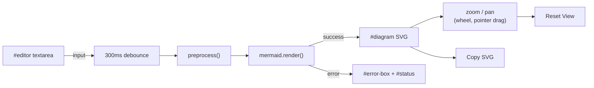

# Mermaid Preview

A fault-tolerant, browser-based Mermaid diagram previewer designed for pasting diagrams directly from LLM (ChatGPT, Claude, etc.) responses — without needing to manually fix common formatting issues.

## Live Demo

**[https://xiaokangs.github.io/mermaid-preview/](https://xiaokangs.github.io/mermaid-preview/)**

No install needed — open the link and start pasting.

## Why this exists

LLMs frequently generate Mermaid diagrams that look correct but fail to parse due to subtle issues:

- Literal `\n` characters inside `[box]` labels instead of actual line breaks
- Parentheses `()` inside diamond `{}` or box `[]` labels that confuse the parser — this also covers mixed-language labels with ASCII parentheses, e.g. `检查（cache）(hit)`

This tool silently fixes those issues before rendering, so you can paste and preview immediately.

## Features

- **Live preview** — renders as you type, 300ms debounce
- **Fault-tolerant preprocessor** — auto-corrects common LLM output issues before passing to Mermaid
- **Zoom** — scroll to zoom in/out (up to 30x), zooms toward cursor
- **Pan** — click and drag to move around the diagram
- **Reset View** — one click to re-center and restore default zoom
- **Copy SVG** — copies the rendered diagram as SVG markup
- **No install, no build step** — single HTML file, open directly in a browser

## Usage

1. Open `index.html` in any modern browser
2. Paste your Mermaid code into the left editor pane
3. The diagram renders instantly on the right

## Tests

```sh
python3 -m venv .venv && .venv/bin/pip install -r requirements-dev.txt && .venv/bin/playwright install chromium && .venv/bin/pytest
```

pytest + pytest-playwright drive the real `index.html` in headless Chromium (`pytest.ini` pins `--browser chromium`). `tests/conftest.py` replaces the Mermaid CDN script with a fake mermaid and stubs the clipboard, so the tests need no network access.

## Architecture



Everything runs in the browser from `index.html`; Mermaid.js is the only runtime dependency, loaded from the CDN.

## Directory structure

```
index.html            # the whole app: CSS, HTML, JS (preprocess → render → zoom/pan)
docs/design.md        # Apple design-system palette, typography and intentional deviations
tests/                # pytest + Playwright tests (preprocess unit cases, e2e with fake mermaid)
pytest.ini            # pytest config: test path and --browser chromium
requirements-dev.txt  # test-only dependencies (pytest, pytest-playwright)
```

## Preprocessing fixes applied

| Issue | Fix |
|---|---|
| `\n` inside `[box]` labels | Every `\n` replaced with `<br/>` for line breaks |
| `(parens)` inside `{diamond}` nodes | Label auto-quoted to prevent stadium-token parse error |
| `(parens)` inside `[box]` nodes | Label auto-quoted for the same reason (cylinder `[(…)]` and trapezoid `[/…]` / `[\…]` shapes are left alone) |

## Design trade-offs

The UI borrows from Apple's design language — `#f5f5f7` neutrals, a single blue (`#0071e3`) for interactive elements, SF Pro with negative tracking, and a dark translucent glass header. It deliberately deviates where an editor tool needs it: hairline pane dividers, red/green status colors, compact toolbar buttons, a 17px display-font title, and a drop shadow on the diagram. Palette, typography and the full list of deviations are in [docs/design.md](docs/design.md).

## Hosting

This is a static single-file app. Host it anywhere:

- **GitHub Pages** — free, push to a repo and enable Pages under Settings
- **Cloudflare Pages** — free CDN, connect your GitHub repo
- **AWS S3** — enable static website hosting on a bucket

## Tech

- [Mermaid.js](https://mermaid.js.org/) via CDN
- Vanilla HTML/CSS/JS — zero dependencies, zero build tooling

## Status

Live and in use; preprocessing rules are added as new LLM paste failures turn up. Handoff notes, conventions and next steps are in [CLAUDE.md](CLAUDE.md).
